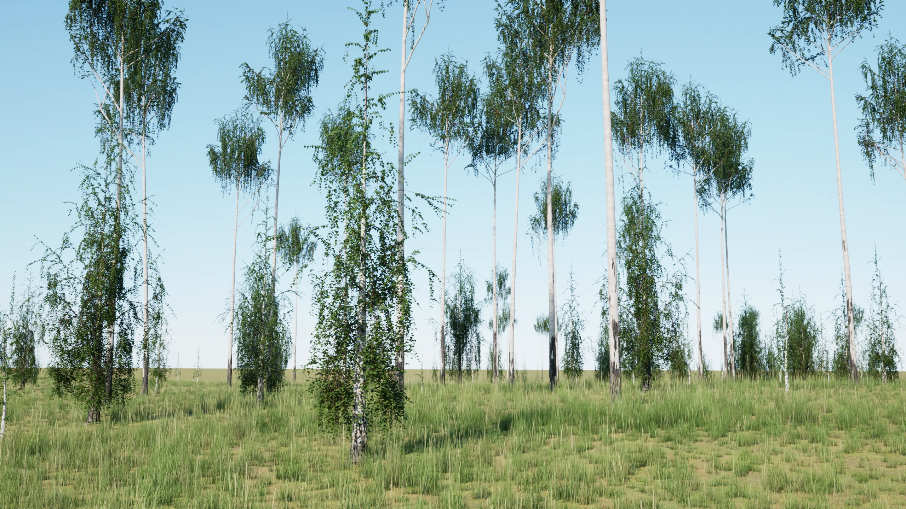
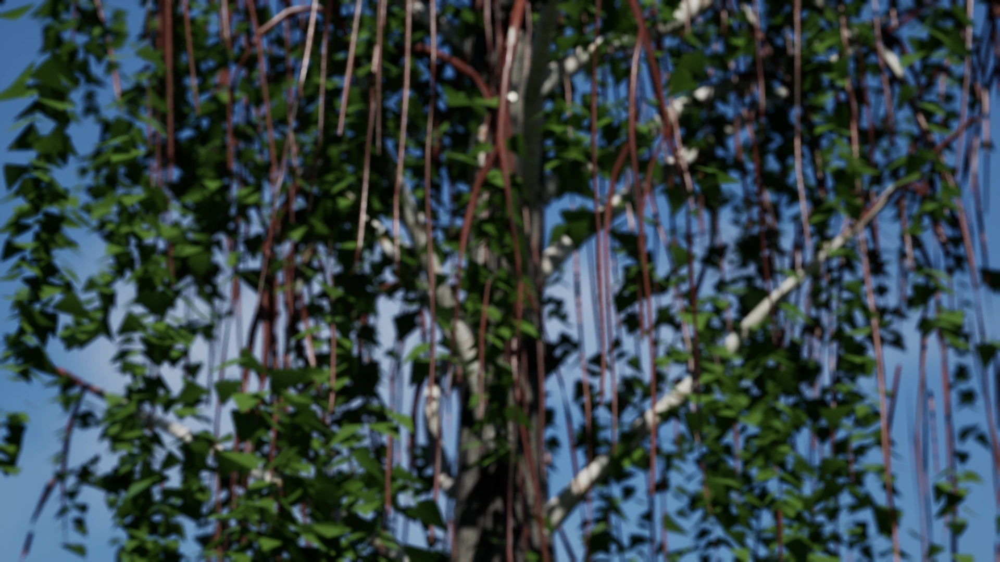
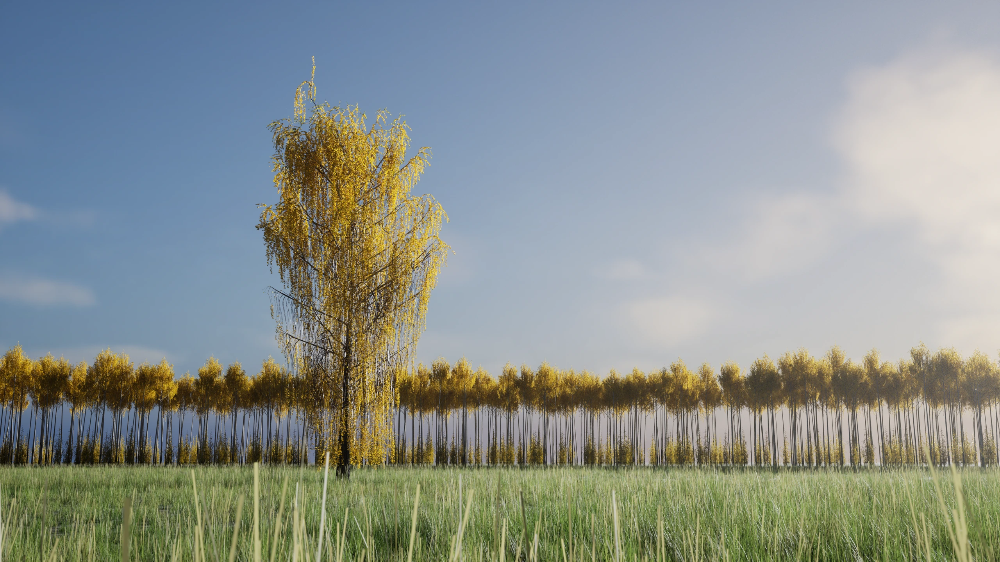
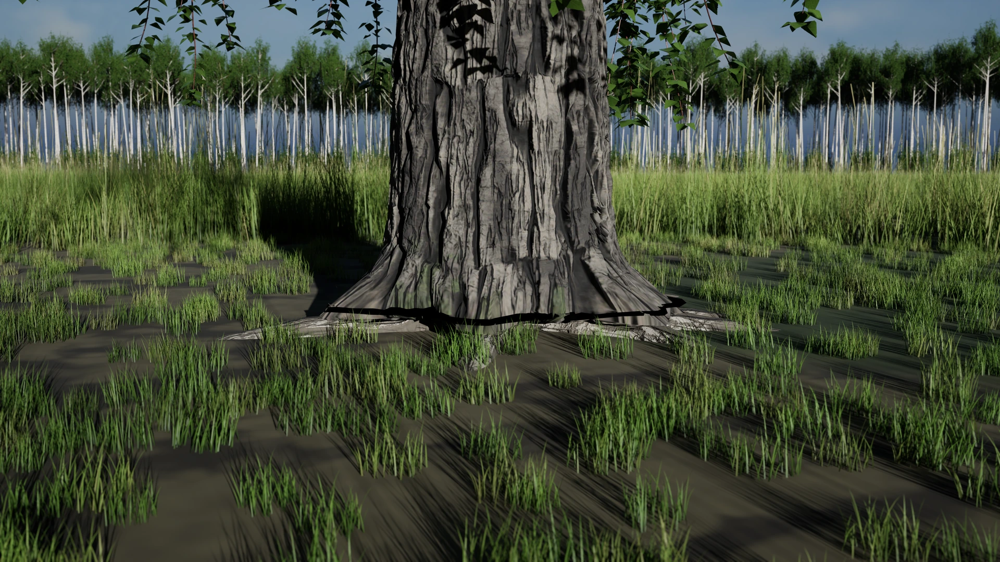
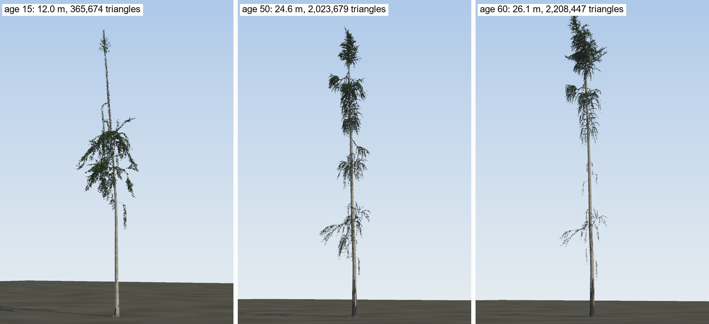
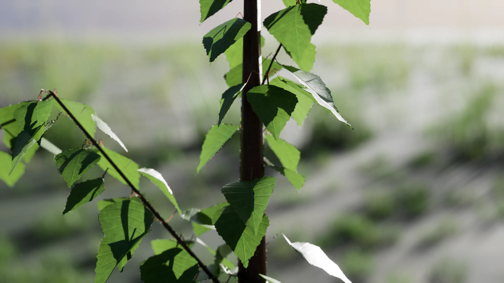
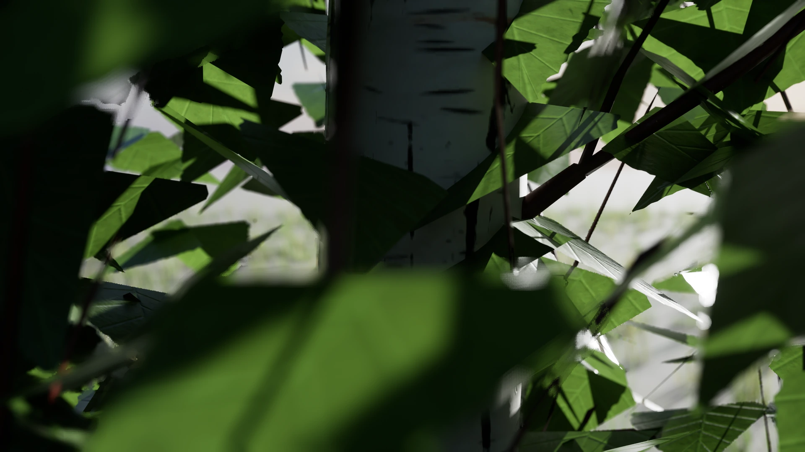
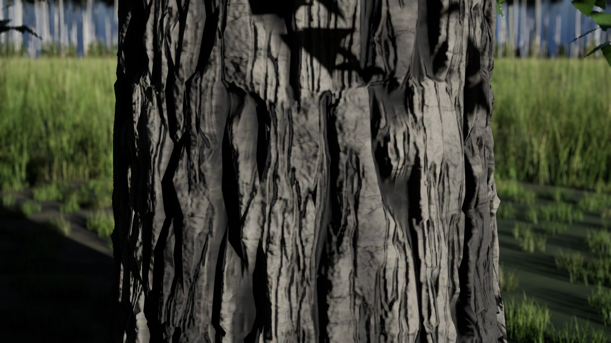

<p align="center">
  
</p>

<h1 align="center">Cambium</h1>

<p align="center"><strong>Trees grown year by year from a seed.</strong></p>

<p align="center">
  
  
  
</p>

<p align="center">
  <a href="#features">Features</a> ·
  <a href="#quick-start">Quick start</a> ·
  <a href="#grounded-in-real-forests">Real forests</a> ·
  <a href="#roadmap">Roadmap</a>
</p>

<p align="center">
  
  <br><sub>Inside a birch wood grown by Cambium, path-traced in Unreal Engine. The trees are the model's output; the sky, ground and rocks are Poly Haven CC0 scans.</sub>
</p>

https://github.com/user-attachments/assets/92d34dc3-25dd-46fa-9fc0-2855a6793458

<p align="center"><sub><b>Seed to 60 years.</b> Each frame is the tree Cambium grew by that age, path-traced in Unreal Engine.</sub></p>

Cambium grows a tree from a seed, one year at a time. Height follows a published growth curve for the site. Around
that, buds compete for light, shaded branches die back, and wood, leaves and roots are built from the carbon the
tree fixes. Put many together and they shade each other, thin each other out and become a forest.

No two seeds give the same tree, and the same seed gives the same tree again on the same machine and library
versions. The first species is the silver birch.

https://github.com/user-attachments/assets/c73bbbd7-f74c-4835-9988-0aa3edc66011

<p align="center"><sub><b>A year of seasons</b>, leaf colour from the model's own season rule.</sub></p>

https://github.com/user-attachments/assets/1f7a2497-30c3-4662-bbfd-7276b18856b1

<p align="center"><sub><b>All the way round</b> at 60 years.</sub></p>

https://github.com/user-attachments/assets/e2807019-4082-4453-aa3e-8a605fc22181

<p align="center"><sub>The 60-year birch in the wind. The tree is the model's; the wind is a shader effect in Unreal, as in a game. Known fault: the twigs hang far more than a wild silver birch's do; it is being fixed.</sub></p>

## Features

<table>
  <tr>
    <td width="50%" valign="top">
      
      <h3>Grown, not modelled</h3>
      Every branch is there because the tree grew it. Shape comes from light, carbon and mechanics, not presets.
    </td>
    <td width="50%" valign="top">
      
      <h3>Seasons and age</h3>
      Spring leaf-out to autumn yellow and bare winter. Bark whitens as the tree ages and darkens at the base.
    </td>
  </tr>
  <tr>
    <td width="50%" valign="top">
      
      <h3>Roots too</h3>
      A full root system that anchors the tree against wind, and comes up with it when it falls.
    </td>
    <td width="50%" valign="top">
      
      <h3>Made for games</h3>
      Exports GLB and USD meshes with detail levels and the tree's whole growth history. Built for a game in Unreal.
    </td>
  </tr>
</table>

<table>
  <tr>
    <td width="33%" align="center"><br><sub><b>6 years:</b> red-brown stem, toothed leaves</sub></td>
    <td width="33%" align="center"><br><sub><b>20 years:</b> white bark, dark lenticels</sub></td>
    <td width="33%" align="center"><br><sub><b>60 years:</b> black, fissured foot</sub></td>
  </tr>
</table>
<p align="center"><sub>The bark changes as the tree ages. Geometry and bark are the model's output; Unreal only lights them (path traced, 4K).</sub></p>

## Quick start

```bash
git clone https://github.com/rar-file/cambium.git && cd cambium
pip install .                                                       # Python 3.12-3.14

cambium grow --species birch --seed 7 --years 60                    # a lone tree
cambium grow --species birch --seed 7 --years 60 --forest --export glb   # a forest tree, as a game mesh
cambium forest --seed 1 --years 40                                  # a small forest
```

Or from Python:

```python
import cambium

tree = cambium.grow("birch", seed=7, years=60)
print(tree.height_m, tree.dbh_cm)        # size at 60
tree.stats.to_csv()                      # every year of its life
tree.export("out/birch_7", format="glb")  # meshes for a game engine
```

Results land in `out/`. For bit-for-bit identical results, use Python 3.14.7 with `requirements.lock`.

**Coming soon:** `pip install pycambium` from PyPI, a ready-made birch pack to download, an Unreal import script,
and a website with a 3D viewer.

## Grounded in real forests

Cambium is built from published forestry science. Every setting in the birch is labelled: taken from a published
source, derived from one, tuned (with what it was tuned against), or still unchecked. About a fifth are sourced.
Grown forests are compared with measured Nordic and Baltic birch stands.

**Where it stands at 50 and 60 years** (20 forests, fresh run of 2026-11-09):

| Measure | Age 50 | Age 60 | Real figure | What kind of check |
|---|---|---|---|---|
| Top height | 21.4 m | 23.1 m | 21.95 / 23.75 m (site curve) | by design, not a test |
| Light under the canopy | 18.2 % | 19.5 % | 6.4-19.8 % | tuned against |
| Leaf area index | 4.51 | 4.29 | at most 4.5 (Baltic stands) | tuned against; misses by 0.01 at 50 |
| Branch wood over Repola's equation | 1.47 | 1.76 | 1.00 | tuned against; a miss |
| Spread of stem diameters | 0.15 | 0.15 | 0.32 at 45 years | untuned; a miss |

No independent test at 50 or 60 years has been passed yet: the checks above were either built in or tuned to.
An independent review, a full audit and the fresh run are in [`reports/`](reports/).

**Known faults:** the twigs hang far more than a wild silver birch's do; the forest is too even (trees too alike
in size); branches carry too much wood; young forests are leafier than Baltic measurements; old forests past 100
years are not sound yet. Everything we know about is in [`KNOWN_ISSUES.md`](KNOWN_ISSUES.md).

## Roadmap

- **1.0:** young birch fixed, and tested against data the model has never seen.
- **More trees:** Scots pine next, then Norway spruce and mixed forests.
- **For games:** felling, and branches that fall to the ground.

## Contributing

Pull requests are welcome. Tests must pass, and new values need a published source. See
[`CONTRIBUTING.md`](CONTRIBUTING.md).

<details>
<summary><strong>Cite Cambium</strong></summary>

```bibtex
@software{cambium,
  author  = {rar-file},
  title   = {Cambium: a tree growth model guided by published growth curves},
  year    = {2026},
  version = {0.9},
  url     = {https://github.com/rar-file/cambium}
}
```
</details>

## Licence

Apache 2.0 ([`LICENSE`](LICENSE)). The comparison photos in `reference/` keep their own open licences, credited in
[`reference/CREDITS.md`](reference/CREDITS.md).
